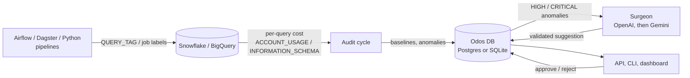

# Odos Auditor

[](https://github.com/odidere/odos_auditor/actions)

Odos finds the queries that suddenly cost more than they should, tells you which pipeline ran them, and asks an LLM for a cheaper rewrite that **a person approves or rejects**. It works with **Snowflake** and **BigQuery**.

- **Cost per query, attributed to pipelines.** Odos tags each query with its DAG, task and run through Snowflake's `QUERY_TAG` (or BigQuery job labels), then reads per-query cost from the warehouse's own usage views.
- **Anomalies against a per-query baseline.** Each query shape gets its own moving baseline, so a nightly job that jumps from $2 to $20 is flagged even when total spend looks normal.
- **AI suggestions with guardrails.** Only flagged queries go to the model, with literal values redacted. Rewrites are validated and stored for review. Odos never runs them.
- **Warehouse advice.** Idle cost (billed compute that ran no queries) and right-sizing hints.

## How it works



1. **Tag.** `instrument_all()` sets `QUERY_TAG` to a small JSON payload (`{"odos":1,"dag":...,"task":...,"run":...}`) whenever the pipeline context changes. The query text is never modified, so Snowflake's result cache keeps working.
2. **Collect.** The Snowflake source reads `QUERY_ATTRIBUTION_HISTORY` (credits per query) joined to `QUERY_HISTORY`. The BigQuery source reads `INFORMATION_SCHEMA.JOBS_BY_PROJECT` and prices bytes billed (on-demand) or slot time (Editions).
3. **Detect.** Queries are grouped by a stable fingerprint (the warehouse's parameterised hash, or a SHA-256 of the SQL with literals removed). A run is flagged when it costs more than 3x its baseline **and** more than its usual variation, and the excess is at least $1. All thresholds are configurable.
4. **Suggest.** For new HIGH/CRITICAL anomalies, the Surgeon sends the redacted query to the model, with a timeout and token limit, and checks the answer: valid JSON, one read-only statement, no new tables. Valid rewrites are stored as `PENDING`; anything else is stored as `INVALID` or `FAILED` with the reason.
5. **Review.** A person approves or rejects each suggestion in the dashboard, API or CLI. Every decision is logged to a JSON Lines file, which shows how often each model's suggestions are accepted.

## Quick start (demo data, no warehouse needed)

```bash
python -m venv .venv && source .venv/bin/activate
pip install -e ".[api,ui,ai]"

odos init-db                    # creates odos.db (SQLite) unless DATABASE_URL is set
odos audit --source mock        # 3 demo pipelines, one with a cost spike
export OPENAI_API_KEY=...       # optional: enables AI suggestions
odos audit --source mock --suggest
odos suggestions --status PENDING
odos approve 1 --reviewer you --note "Checked against prod plan"

export ODOS_ADMIN_PASSWORD=...  # the dashboard has no default password
odos ui                         # http://localhost:8501
odos api                        # http://localhost:8000/docs
```

## Using it with Snowflake

1. Install: `pip install -e ".[snowflake,postgres,api,ui,ai]"`.
2. Create a **read-only** role with access to `SNOWFLAKE.ACCOUNT_USAGE` (for example via the `USAGE_VIEWER` and `GOVERNANCE_VIEWER` database roles). Do not use `ACCOUNTADMIN`.
3. Set `SNOWFLAKE_ACCOUNT`, `SNOWFLAKE_USER`, `SNOWFLAKE_ROLE`, `SNOWFLAKE_WAREHOUSE` and either `SNOWFLAKE_PRIVATE_KEY_FILE` (preferred) or `SNOWFLAKE_PASSWORD`. See `.env_template`.
4. Tag your pipelines (next section), then schedule `odos audit --source snowflake --lookback-days 1` (for example hourly). `ACCOUNT_USAGE` views lag by up to a few hours, and re-running over the same window is safe.

## Tagging pipelines

```python
# Any Python pipeline
from odos.agent.instrument import track_pipeline

@track_pipeline(name="nightly_orders", inputs=["raw.orders"], outputs=["analytics.orders"])
def nightly_orders():
    ...  # Snowflake queries in here are tagged; the run and lineage are recorded

# Airflow: a drop-in operator...
from odos.agent.airflow_plugin import OdosSnowflakeOperator
# ...or tag every task without changing DAGs: use odos.airflow_local_settings.task_policy

# Dagster
from odos.agent.dagster_plugin import OdosResource

@asset
def orders(context, odos: OdosResource):
    with odos.step(context):
        ...

# BigQuery: pass the context as job labels
from odos.agent.context import OdosContext
job_config = bigquery.QueryJobConfig(labels=OdosContext.bigquery_labels())
```

## Configuration

`config.yaml` (or the file in `ODOS_CONFIG`) overrides the defaults in `odos/config.py`. Secrets come only from environment variables.

| Setting | Default | Meaning |
|---|---|---|
| `source.type` | `mock` | `snowflake`, `bigquery` or `mock` (or `ODOS_COST_SOURCE`) |
| `costs.compute_credit_price` | 3.00 | USD per Snowflake credit: set your contract price |
| `costs.bigquery_price_per_tib` / `bigquery_slot_hour_price` | 6.25 / 0.06 | BigQuery prices |
| `detection.*` | 5 runs, 3x, 4 deviations, $1 | When a run counts as an anomaly |
| `ai.openai_model` / `ai.gemini_model` | `gpt-4.1-mini` / `gemini-2.5-flash` | Models (or `ODOS_OPENAI_MODEL` / `ODOS_GEMINI_MODEL`) |
| `ai.send_literals` | `false` | Keep literal values out of prompts |
| `ai.timeout_sec` / `max_output_tokens` | 30 / 1500 | Per-call limits |

## Evaluating the AI

`eval/cases.jsonl` holds 12 known-expensive query patterns (non-sargable filters, `UNION` vs `UNION ALL`, correlated subqueries, missing join conditions and more). `odos eval` runs them through your configured provider and reports the share of answers that are valid, safe and name the right technique. Run it whenever you change prompts or models; it costs a few cents.

## Safety

- **Fail-open:** if tagging or recording fails, the query or pipeline runs unchanged and Odos logs a warning.
- **No automatic changes:** Odos never executes AI output. Approval records a decision only.
- **Data minimisation:** literals are redacted before prompts and in stored samples; secrets are masked in stack traces.
- **Least privilege:** read-only warehouse roles; the API can require `X-API-Key` (`ODOS_API_KEY`); the dashboard needs `ODOS_ADMIN_PASSWORD`.
- The storage advisor's archival template leaves its `DELETE` commented out.

## Project layout

```
odos/
  agent/        tagging (context, instrument), Airflow and Dagster plugins
  sources/      Snowflake, BigQuery and mock cost sources
  backend/      schema, audit cycle, detection, advisor, surgeon, remediation, API, UI
  fingerprint.py, config.py, cli.py, evaluation.py
eval/           AI evaluation cases
tests/          unit and integration tests (offline)
```

## Roadmap

- Alembic migrations (tables are currently created with `odos init-db`)
- Before/after cost comparison for approved suggestions
- Migrate `system_testing/` to the new schema
- Databricks SQL cost source
- An agent that answers cost questions from `INFORMATION_SCHEMA` (Google ADK)

## Development

```bash
pip install -e ".[dev,api,ai,snowflake]"
pytest -q
```

See [CONTRIBUTING.md](CONTRIBUTING.md).
